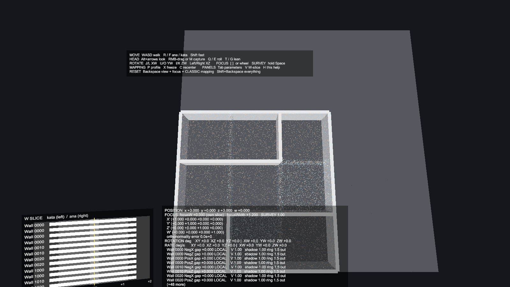

# 4Dex: 4D VR Perception Engine

An experimental VR environment with four spatial dimensions, built for Oculus Rift PCVR in
Unity. It is a perception and navigation engine first and a maze game second.

The central design question:

> How can VR give a human an intuitive sensory language for perceiving,
> inspecting, rotating through, and navigating four spatial dimensions?



## Status

**All milestones in SPEC §24 (1–9) are implemented and pass their acceptance tests on
the desktop.** SPEC §22 comfort (motion vignette, snap turning) is also done. Milestone 0's
in-headset run is still open: the XR rig is built and unit-tested, but the 4D mappings
haven't been tried in the Rift yet.

| Milestone | What it adds |
| --- | --- |
| 1. W-focus | Objects at a signed W distance from your focus show phase stripes, dither and shimmer. The ana/kata sign shows without relying on colour. |
| 2. Ana/kata translation | Move along W independently of focus. |
| 3. 4D rotation | XW / YW / ZW rotations turn the 3D subspace you see. |
| 4. Input mapping | Head motion maps to 4D through swappable profiles, with no code changes. |
| 5. Survey mode | Hold to see neighbouring W geometry as echoes. |
| 6–7. 4D shadows | Occluders outside your W slice still cast shadows, with ripple, shear and echo cues. |
| 8. 4D cells | Cells with walls and collision. A wall only blocks you within its own W slice. |
| 9. Procedural maze | Seeded depth-first maze over the 4D adjacency graph. |

Test scenes: `Lab4D`, `Box4D`, `Cells4D`, `Maze4D`, `Rooms4D` (81 rooms) and `Hall4D` (a
corridor whose barrier exists in one W slice only).

## Running it

- **Unity 6000.6.2f1**, URP, OpenXR (Oculus Touch profile). Open the repo root as the
  Unity project. If XR isn't set up, use **4Dex > Configure XR**.
- Each scene in `Assets/Scenes/` is generated by an editor builder. To regenerate one, use
  **4Dex > Rebuild … Scene** instead of editing it by hand.
- You don't need a headset. Desktop test mode simulates the HMD with the mouse and drives
  everything from the keyboard:

```
MOVE    WASD walk   R / F ana / kata   PgUp / PgDn fly   Shift fast
HEAD    Alt+arrows look   RMB-drag or M capture   Q / E roll   T / G lean
ROTATE  J/L XW   U/O YW   I/K ZW   Left/Right XZ
FOCUS   [ ] or mouse wheel          SURVEY  hold Space
MAPPING P profile   X freeze   C recenter
PANELS  Tab parameters   V W-slice   H help
RESET   Backspace view + focus + mapping   Shift+Backspace everything
```

## Layout

```
src/4Dex.Math4D/        Vec4, Rotor4 (pair of unit quaternions), Basis4: pure .NET
src/4Dex.World4D/       objects, cells, maze topology, collision, maze generation
src/4Dex.Player4D/      player state (position.w, orientation, focusW), comfort
src/4Dex.Perception4D/  signed W gap -> perceptual bands and channels, shadow model
src/4Dex.Input4D/       generalized input mapping engine and presets
tests/4Dex.Tests/       engine-free tests, `dotnet test 4Dex.Core.sln`
Assets/4Dex/            Unity: runtime wrappers, XR rig, shaders, debug tools, EditMode tests
docs/                   SPEC.md, ARCHITECTURE.md, reference renders in images/
```

The `src/` libraries never reference `UnityEngine`. This lets the mathematical core build
and test anywhere without Unity, and the compiler enforces "Math4D knows nothing about XR".
Unity uses the same sources as the local package `com.fourdex.core`.

## Building and testing

```
dotnet test 4Dex.Core.sln
```

Unity EditMode tests are run from the Test Runner, or headlessly with `-runTests
-testPlatform EditMode`.

## Documents

| File | Contents |
| --- | --- |
| `docs/SPEC.md` | The master engineering specification. The authoritative requirements. |
| `docs/ARCHITECTURE.md` | Technical architecture, the math behind 4D orientation, milestone plans, risks. |
